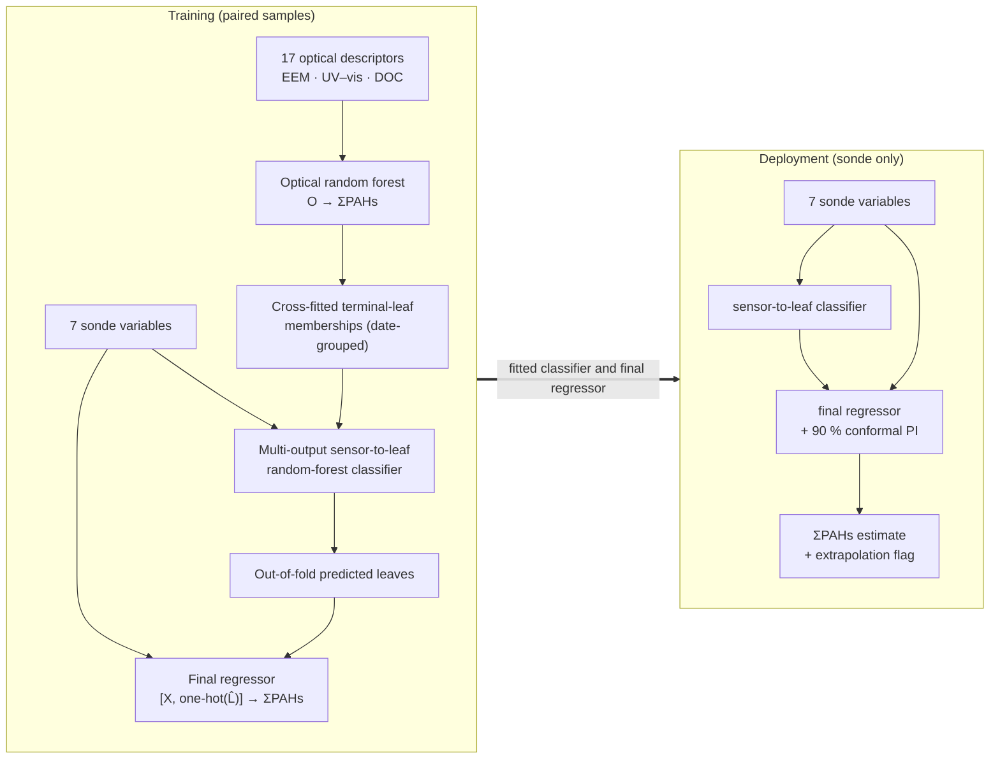

# CascadePAHs

**Robotic sensing–sampling and privileged-information learning for high-frequency surrogate reconstruction of dissolved PAHs**

Code for: Zhang C., Xiao P., Guo L., *et al.* Robotic sensing–sampling and privileged-information learning for high-frequency surrogate reconstruction of dissolved PAHs. *Water Research* (in review).


This repository implements every algorithm used in the study:

* **SOLACE** — the *Sensor-to-Optical Leaf-Mapping Cascaded Estimator*. Laboratory EEM fluorescence, UV–vis absorbance and DOC descriptors (17 "optical descriptors") are used **only during training**. Prediction needs only the seven EXO2 sonde variables (temperature, pH, DO, salinity, turbidity, chlorophyll-a, FDOM).
* **SORFE** — the *Sensor-Only Random-Forest Estimator* baseline, plus the other five sensor-only algorithms (SVR, L2-regularised linear regression, XGBoost, MLP, DNN) and their privileged-information "-P" variants.
* Date-grouped validation: random 80:20 (reference), leave-one-date-out, contiguous date blocks (primary), winter→summer. Also block-length, buffer, offset and station-exclusion sensitivity analyses, paired date-level bootstrap CIs and a leakage-invariance test.
* Complexity-matched controls and alternative uses of the optical data: capacity control, shuffled control, two-stage regression, generalized distillation, **SVR+** (Vapnik & Vashist, 2009), multi-task learning, ablations of the EEM / UV–vis / DOC groups and non-deployable reference models. Also oracle leaves and leaf-agreement diagnostics.
* 90 % prediction intervals: a quantile regression forest final stage plus conformalized quantile regression with date-grouped conformity scores. Also calibration-domain (extrapolation) flags, screening and interval triage.
* SHAP attributions for the optical forest, SORFE and the complete SOLACE pipeline, and the sensor-to-optical predictability of each descriptor.
* Few-shot cross-site calibration (10 samples from a single sampling day, 200 draws per day), direct transfer, calibration-size curves, local-model and linear-correction comparisons, permutation importance.
* High-frequency reconstruction of sonde survey records with intervals and extrapolation flags, and application to the 22 July–22 August 2024 period.
* Data preparation: sonde QA/QC, sensor–sample matching, UV–vis and EEM optical descriptors, non-negative **PARAFAC** with split-half validation, ΣPAHs from congeners (½·LOD substitution, LMW/MMW/HMW groups, EU EQS comparison), and the descriptive statistics of the paper (ANOVA/ICC by date, Kruskal–Wallis ε², rainfall lag correlations, residual autocorrelation, MANOVA).

`data/demo/` contains demo data for running the code. The values are simulated (not measurements) and do not reproduce the results of the paper. The measured data are provided as Supplementary Data with the article; see [`data/README.md`](data/README.md) for the format. For data requests, please contact congchaozhang@stu.hit.edu.cn.

---

## Workflow



## Repository layout

```
CascadePAHs/
├── src/cascadepahs/
│   ├── models/
│   │   ├── solace.py        SOLACE (+ -P variants, capacity / shuffled controls, oracle leaves, leaf agreement)
│   │   ├── sorfe.py         SORFE and the other sensor-only models
│   │   ├── base.py          six algorithms, Table S28 grids, date-grouped tuning
│   │   ├── qrf.py           quantile regression forest
│   │   ├── conformal.py     conformalized quantile regression (date-grouped scores)
│   │   ├── svr_plus.py      SVR+ (regression SVM+), dual QP
│   │   └── controls.py      two-stage regression, generalized distillation, multi-task learning, references
│   ├── validation.py        schemes (a)–(d), blocks / buffers / offsets / station exclusion, CV runner, leakage test
│   ├── metrics.py           R², MAE, RMSE, bias, paired date-level bootstrap, Wilcoxon / sign tests, screening
│   ├── calibration.py       few-shot cross-site calibration, direct transfer, size curves, permutation importance
│   ├── interpret.py         SHAP (shap package or exact / sampled interventional Shapley values)
│   ├── optics.py            UV–vis and EEM descriptors (IFE, Raman units, scatter removal, FI/BIX/β:α/HIX …)
│   ├── parafac.py           non-negative PARAFAC (HALS), split-half validation, Fmax
│   ├── pahs.py              ΣPAHs, LOD handling, ring-number groups, EU EQS
│   ├── sonde.py             sonde QA/QC, sensor–sample matching, calibration domain
│   ├── stats.py             ANOVA/ICC, Fisher, χ², Kruskal–Wallis ε², lag correlations, ACF, MANOVA
│   ├── deploy.py            high-frequency reconstruction
│   ├── demo_data.py         demo data (simulated)
│   └── plotting.py          figures of the paper
├── scripts/                 numbered analysis scripts (00–11) + run_all.py
├── configs/                 default.yaml (full protocol), fast.yaml (demo), smoke.yaml (quick check)
├── data/demo/               demo data (format: data/README.md)
├── docs/METHODS.md          algorithm details and their correspondence to the paper
├── examples/quickstart.py   minimal use of SOLACE on your own data
└── tests/                   pytest suite (includes the leakage-invariance test)
```

## Installation

```bash
git clone https://github.com/UrbanWaterHIT/CascadePAHs.git
cd CascadePAHs
python -m venv .venv && source .venv/bin/activate      # or: conda env create -f environment.yml
pip install -r requirements.txt
pip install -e .
```

Python ≥ 3.9. `xgboost` and `shap` are listed in `requirements.txt`. If they are missing, the code falls back to scikit-learn `GradientBoostingRegressor` (same four hyper-parameters) and to exact or sampled interventional Shapley values, with a warning.

## Quick start (demo data)

```bash
python scripts/run_all.py --config configs/fast.yaml      # ≈ 1.5–2 h on 2 CPU cores
pytest -q                                                   # unit tests, including the leakage-invariance test
```

Or run individual steps, e.g. `python scripts/04_source_domain_validation.py --config configs/fast.yaml`.
Results (CSV tables and PNG figures) are written to `results/<step>/`.

`configs/default.yaml` runs the full protocol of the paper: Table S28 grids tuned inside every training set, 50 random splits, 200 calibration draws, 2,000 bootstrap resamples and all block offsets. Expect on the order of a day on an 8-core desktop: a single fully tuned SOLACE fit takes several minutes, and the cross-site analysis refits the models 200 times per calibration day. Use `n_jobs` to parallelise over folds and draws. With 200–300 optical trees, the multi-output leaf classifier needs a few GB of RAM per parallel job.

## Paper items → scripts

| Item in the paper | Script | Main outputs (`results/…`) |
|---|---|---|
| Sonde QA/QC, sensor–sample matching, sample-loss tests, Tables S1, S3–S5, S12, S23, S29, Fig. S6, EQS, ANOVA/ICC, Table S27, Table S9 | `01_data_qc_and_descriptive_stats.py` | `01_data/*.csv` |
| Optical descriptors (Note S1.3), PARAFAC (Note S2.1, Figs. S7–S9) | `02_optical_descriptors.py` | `02_optics/` |
| Fig. 3a (127 subsets × 6 algorithms) | `03_sensor_subset_benchmark.py` | `03_subsets/` |
| Table 1, Figs. 3b–g and 4, Tables S18, S19, S24 (SORFE/SOLACE), residual ACF | `04_source_domain_validation.py` | `04_source_validation/` |
| Table S20 (block lengths, buffers, offsets), Table S30 (station exclusion), seed replicates, leakage test | `05_sensitivity_analyses.py` | `05_sensitivity/` |
| Table S17 and S24 (controls, SVR+, MTL, distillation, ablations, references), leaf diagnostics of the ablations, negative control | `06_controls_and_ablations.py` | `06_controls/` |
| 90 % PIs, coverage, width, screening and triage (Note S3.6) | `07_prediction_intervals.py` | `07_intervals/` |
| Fig. 5 (SHAP a–c, descriptor predictability d), Table S22 | `08_shap_interpretation.py` | `08_shap/` |
| Direct transfer (Figs. S12–S13), Tables S21, S25, S26, Figs. 6a–f, S14, S15 | `09_cross_site_calibration.py` | `09_calibration/` |
| Fig. 6g (application period), high-frequency reconstruction, extrapolation flags | `10_field_application.py` | `10_application/` |
| Table S16 (congener and molecular-weight-group models) | `11_congener_and_group_models.py` | `11_congeners/` |

## Using the measured data

1. Export the Supplementary Data to the CSV files described in [`data/README.md`](data/README.md): paired samples, on-station readings, high-frequency records, application-period samples and rainfall. Optionally add raw spectra.
2. Copy `configs/default.yaml`, edit the `paths:` block, and run the scripts with `--config your.yaml`. Skip `00_demo_data.py`.

## Using SOLACE in your own code

```python
from cascadepahs.models import SOLACE, SORFE, ConformalIntervalModel

model = ConformalIntervalModel(
    SOLACE(optical_params={"n_estimators": 200, "min_samples_leaf": 8},
           classifier_params={"n_estimators": 200}, final_params={"n_estimators": 300},
           quantile=True, n_inner=5, random_state=42),
    alpha=0.10)
model.fit(X_train, y_train, groups=survey_dates, O=optical_train)   # optics used only here
y_hat = model.predict(X_new)                                        # seven sonde variables only
pi90 = model.predict_interval(X_new)
```

See [`examples/quickstart.py`](examples/quickstart.py) and [`docs/METHODS.md`](docs/METHODS.md).

## Implementation notes

* **No leakage.** The held-out fold is never passed to `fit`. Scaling, tuning, optical-leaf construction, classifier fitting and the conformal scores are all estimated inside each training set with inner folds grouped by survey date. `tests/test_leakage.py` randomises the ΣPAHs and optical data of held-out samples and checks that their predictions are unchanged.
* **Cross-fitted leaf targets.** The reference optical forest, fitted on all training samples, defines the leaf vocabulary. Out-of-fold targets come from inner-fold forests fitted without the sample's date group: in each tree, a sample is assigned the reference leaf held by the majority of its co-members (`leaf_targets="crossfit"`; `"insample"` is also available). The final regressor is trained on out-of-fold *predicted* leaves, so training and deployment use leaf features of the same kind.
* **Leaf size.** The optical forest uses `min_samples_leaf = 8`, which keeps the leaf vocabulary compact (mean chance leaf agreement ≈ 0.13) and the memory of the multi-output classifier moderate.

## Citation

If you use this code, please cite the article and this repository (see `CITATION.cff`).

## License

MIT (see `LICENSE`).

## Contact

congchaozhang@stu.hit.edu.cn

For questions about the code, please open an issue on GitHub.
